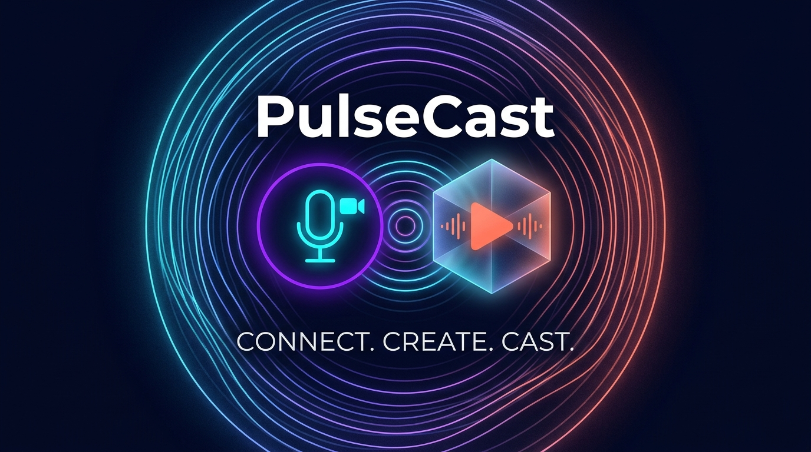
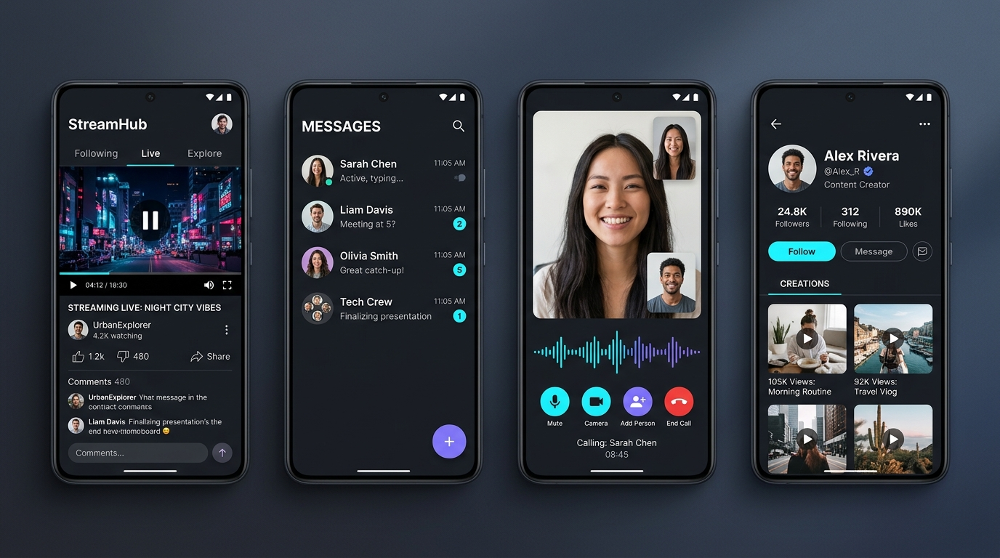
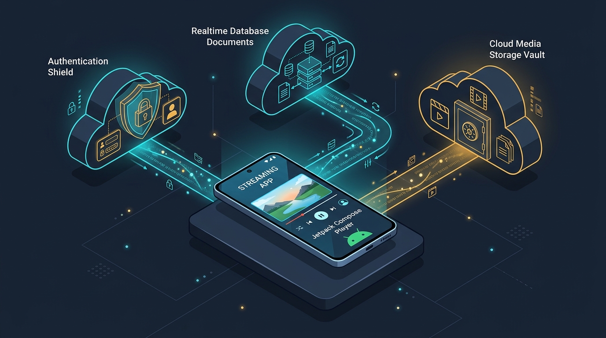

<div align="center">



# PulseCast

**Audio-Video Calling · Real-Time Messaging · Creator Video Publishing**

-3DDC84?style=for-the-badge&logo=android&logoColor=white)


</div>

---

## Overview

**PulseCast** is a modern native Android creator platform built with **Kotlin** and **Jetpack Compose (Material 3)**. It unifies four core experiences inside an adaptive single-activity shell (`NavigationBar` on compact screens and `NavigationRail` on tablets/foldables):

1. **Creator Video Feed & Publishing** — Browse categorized public clips (`Tech`, `Studio`, `Podcast`, `Music`, `Vlog`, `Live`), watch streams with a custom **Media3 ExoPlayer** player, like and comment in real time, and upload new videos via a dedicated **Firebase Storage + Firestore** upload form.
2. **Real-Time Messaging** — Searchable conversation inbox (`ChatListScreen`), 1-to-1 and group chat rooms, text messages, image sharing, voice note recording, and live read receipts.
3. **Audio & Video Calling** — Create or join room-coded audio, video, and group call sessions with CameraX preview and runtime permission management.
4. **Creator Studio & User Profile** — View your Google-authenticated profile, follower-facing `@handle` and bio, upload metrics, preference toggles, and manage your uploaded **Public** and **Private Draft** videos.

---

## Interface Showcase

<div align="center">



*From left to right: Video Feed & ExoPlayer, Real-Time Chats, Audio/Video Calling, and Creator Studio Profile.*

</div>

### Bundled Studio Artwork

| Authentication Hero | Studio Cover Art | Stage Cover Art |
| :---: | :---: | :---: |
|  |  |  |
| Google Sign-In landing banner | Default studio video cover | Default stage video cover |

---

## Architecture & Cloud Data Flow

<div align="center">



</div>

PulseCast follows **MVVM + Repository** architecture with unidirectional state flow (`StateFlow` + `collectAsStateWithLifecycle`) and zero-trust Firebase security boundaries:

- **Authentication (`GoogleAuthManager`, `AuthScreen`)**: Uses **Jetpack Credential Manager** (`GetSignInWithGoogleOption` & silent `GetGoogleIdOption`) paired with **Firebase Authentication**. All Firestore listeners and writes are strictly gated behind an authenticated user session.
- **Database (`PulseCastRepository`, `firestore.rules`)**: Real-time `.snapshots()` flows backed by Cloud Firestore (named database configured in `firebase_applet_config.xml`) with schema-validated security rules (`users`, `creators`, `videos`, `likes`, `comments`, `chats`, `messages`, `call_sessions`).
- **Media Storage & Playback (`FirebaseStorageVideoUploader`, `PulseCastVideoPlayer`)**:
  - Local clips selected via zero-permission Android Photo Picker (`PickVisualMedia`) or recorded via `CaptureVideo` + `FileProvider` stream to **Firebase Storage** (`videos/{uid}/{videoId}.{ext}`) with live progress reporting before persisting metadata to Firestore.
  - Playback is powered by **Media3 ExoPlayer** with buffering states, seekbar scrubbing, playback speed (`1.0x`, `1.5x`, `2.0x`), mute toggle, error retry, and lifecycle pause/release.
- **Runtime Permissions (`PermissionManager`)**: Reusable **Accompanist Permissions** wrapper handling rationale cards, runtime prompts, and permanent-denial settings recovery for `CAMERA` and `RECORD_AUDIO`.

---

## Tech Stack

| Layer | Technology |
| :--- | :--- |
| **Language & UI** | Kotlin `2.2.10`, Jetpack Compose BOM `2024.09.00`, Material 3, Edge-to-Edge |
| **Media & Camera** | Jetpack Media3 ExoPlayer `1.11.1`, CameraX `1.5.0`, MediaMetadataRetriever, MediaRecorder |
| **Backend & Cloud** | Firebase BoM `34.17.0` (Firebase Auth, Cloud Firestore, Firebase Storage) |
| **Identity** | AndroidX Credential Manager `1.5.0`, Google Identity Services (`googleid`) |
| **Permissions & Images** | Accompanist Permissions `0.37.3`, Coil Compose `2.7.0` |
| **Testing** | JUnit 4, Robolectric `4.16.1`, Compose UI Test, Firebase Rules Unit Testing (`node:test`) |

---

## Project Structure

```text
├── app/src/main/java/com/example/
│   ├── MainActivity.kt                     # Adaptive NavigationBar / NavigationRail + Auth gate
│   ├── auth/
│   │   └── GoogleAuthManager.kt            # Credential Manager + Firebase Auth sign-in/sign-out
│   ├── data/
│   │   ├── PulseCastModels.kt              # Firestore entity models (@DocumentId, @ServerTimestamp)
│   │   ├── PulseCastRepository.kt          # Realtime flows, batch writes & Storage upload pipeline
│   │   └── FirestoreErrorHandler.kt        # Structured JSON Firestore error logging
│   ├── media/
│   │   ├── MediaHelpers.kt                 # Thumbnail extraction, file metadata, voice recorder
│   │   ├── PulseCastVideoPlayer.kt         # Reusable Media3 ExoPlayer Compose player
│   │   └── VideoStorageUploader.kt         # Firebase Storage upload/cleanup implementation
│   ├── permissions/
│   │   └── PermissionManager.kt            # Accompanist camera & microphone permission wrapper
│   └── ui/
│       ├── PulseCastViewModel.kt           # StateFlows & UI actions
│       └── screens/
│           ├── AuthScreen.kt               # Google Sign-In screen
│           ├── VideoFeedScreen.kt          # Video feed, category filter & VideoDetailScreen
│           ├── VideoUploadForm.kt          # Firebase Storage + Firestore upload form
│           ├── ChatListScreen.kt           # Searchable conversation list
│           ├── MessagingScreen.kt          # Chat threads, media & voice messaging
│           ├── CallsScreen.kt              # Audio/video/group call rooms & CameraX preview
│           ├── StudioProfileScreen.kt      # User profile, stats & uploaded videos manager
│           └── StudioProfileComponents.kt  # Profile header, stat pills & video list cards
├── docs/images/                            # README showcase visuals
├── firestore.rules                         # Zero-trust Firestore security rules
├── storage.rules                           # Owner-scoped Firebase Storage rules
├── firebase-blueprint.json                 # Firestore schema specification
└── firestore.test.js                       # Node emulator security rules test suite
```

---

## Build & Testing

### 1. Firebase Console Prerequisites
- **Firestore & Google Sign-In**: Configured via `app/google-services.json` and `app/src/main/res/values/firebase_applet_config.xml`.
- **Firebase Storage**: Ensure **Firebase Storage** is enabled in the Firebase Console for the project and apply the security rules defined in `storage.rules` so authenticated creators can upload files to `videos/{userId}/{fileName}`.

### 2. Build the Android App
```bash
gradle assembleDebug
```

### 3. Run Unit & Robolectric UI Tests
```bash
gradle :app:testDebugUnitTest
```

### 4. Run Firestore Security Rules Tests (with Firebase Emulators)
```bash
FIRESTORE_EMULATOR_HOST="127.0.0.1:8085" node --test firestore.test.js
```

---

## Web Companion App & Vercel Hosting (`web/`)

The `web/` directory provides a responsive **React + TypeScript + Vite** web companion synced to the exact same Firebase project (`gen-lang-client-0094828632`), Cloud Firestore database, Firebase Storage bucket, and Google Sign-In accounts as the Android app.

### Deploy to Vercel
1. Push this repository to GitHub.
2. In **Vercel**, import the repository and set **Root Directory** to `web`.
3. Add the Firebase Web App environment variables from `web/.env.example` (`VITE_FIREBASE_API_KEY` and `VITE_FIREBASE_APP_ID`, plus optional overrides) under **Project Settings → Environment Variables**.
4. In **Firebase Console → Authentication → Settings → Authorized domains**, add your Vercel deployment domain (e.g., `your-app.vercel.app`).
5. Run locally anytime with:
```bash
cd web
npm install
npm run dev
```

### Package with PWABuilder (`https://www.pwabuilder.com`)
The `web/` companion includes everything required for a full **PWABuilder** score and Android/Desktop/iOS packaging:
- **Web App Manifest (`web/public/manifest.webmanifest`)**: Configured with `id`, `name`, `short_name`, `start_url`, `scope`, `display: "standalone"`, `display_override`, `192x192` & `512x512` `any` + `maskable` PNG icons, `wide` + `narrow` screenshots, and deep-linked app shortcuts (`/?tab=feed`, `chats`, `calls`, `profile`).
- **Service Worker & Offline Support (`web/public/sw.js`, `web/public/offline.html`)**: Registered at `/` scope with pre-cached shell assets, network-first navigation fallback, and automatic network pass-through for Firebase endpoints.
- **Android TWA Verification (`web/public/.well-known/assetlinks.json`)**: Pre-populated for `com.aistudio.pulsecast.vktmrx`; append your Google Play App Signing SHA-256 fingerprint before submitting the PWABuilder Android AAB to Google Play.

---

## GitHub Actions Android APK Release

The repository includes an automated workflow at `.github/workflows/android-release.yml` that runs unit tests, builds the Android APK, and publishes downloadable assets directly to **GitHub Releases**.

### Prerequisite: `app/google-services.json` Configuration
The Android build requires `app/google-services.json` so the Google Services Gradle plugin can generate Firebase configuration resources (such as `default_web_client_id` for Google Sign-In). If your repository or CI/CD build fails with `File google-services.json is missing`, resolve it using **either** method below:

- **Method A — Add `google-services.json` directly to `app/` (Local & Private Repos):**
  1. Open **Firebase Console → Project Settings → Your apps → Android app (`com.aistudio.pulsecast.vktmrx`)** and download `google-services.json` (or copy `app/google-services.json` from your local workspace).
  2. Place the file at **`app/google-services.json`** in your project (`git add app/google-services.json && git commit -m "Add google-services.json" && git push`), or upload it into the `app/` folder directly on GitHub (**Add file → Upload files**).

- **Method B — Use a GitHub Repository Secret (Recommended for CI/CD & Public Repos):**
  1. Generate a single-line base64 string (or copy the raw JSON contents) of `app/google-services.json`:
     - **Linux:** `base64 -w 0 app/google-services.json`
     - **macOS:** `base64 -i app/google-services.json | tr -d '\n'`
     - **Windows (PowerShell):** `[Convert]::ToBase64String([IO.File]::ReadAllBytes("app/google-services.json"))`
  2. In your GitHub repository, go to **Settings → Secrets and variables → Actions → Repository secrets** and click **New repository secret**.
  3. Set **Name** to `GOOGLE_SERVICES_JSON_BASE64` and paste the base64 output into **Secret** (or set **Name** to `GOOGLE_SERVICES_JSON` with the raw JSON text).
  4. The CI workflow automatically restores `app/google-services.json` during the build and removes the temporary file afterward.
  - **Official Guides:** [Firebase Android `google-services.json` Setup](https://firebase.google.com/docs/android/setup#config-file) · [Using Secrets in GitHub Actions](https://docs.github.com/en/actions/security-for-github-actions/security-guides/using-secrets-in-github-actions)

### Option 1: Publish a Release Immediately
1. Ensure `app/google-services.json` is configured via **Method A** or **Method B** above.
2. Trigger the release workflow using either method:
   - **Tag push**: `git tag v1.0.0 && git push origin v1.0.0`
   - **Manual trigger**: Open **Actions → Android APK Release → Run workflow** in GitHub (optionally enter a tag such as `v1.0.0`).
3. Once the workflow finishes, open **Releases** in your GitHub repository and download `PulseCast-<version>-debug.apk` (signed with the repository's pre-registered `debug.keystore.base64` so Firebase Google Sign-In works immediately).

### Option 2: Publish Production-Signed Release APK & AAB (Optional)
If you want an additional release-signed `.apk` and `.aab` for distribution or Google Play:
1. Generate an upload keystore locally with alias `upload`:
   ```bash
   keytool -genkey -v -keystore my-upload-key.jks -keyalg RSA -keysize 2048 -validity 10000 -alias upload
   base64 -w 0 my-upload-key.jks
   ```
2. Add these three **Repository Secrets** in GitHub (**Settings → Secrets and variables → Actions**):
   - `RELEASE_KEYSTORE_BASE64`: Base64 output of `my-upload-key.jks`
   - `STORE_PASSWORD`: Keystore password
   - `KEY_PASSWORD`: Key password
3. Copy the SHA-1 and SHA-256 fingerprints (`keytool -list -v -keystore my-upload-key.jks -alias upload`) into **Firebase Console → Project Settings → Your Android App (`com.aistudio.pulsecast.vktmrx`)** so Google Sign-In works in the release build as well.
4. Trigger the workflow again — GitHub Releases will automatically attach `PulseCast-<version>-release.apk`, `PulseCast-<version>-release.aab`, `PulseCast-<version>-debug.apk`, and `SHA256SUMS.txt`.


